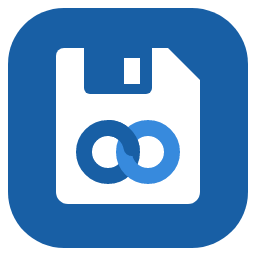
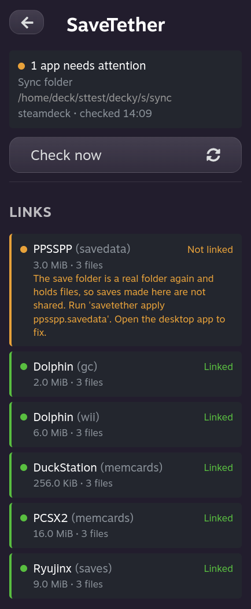

<div align="center">



# SaveTether for Decky

**The health of your synced save folders, in the Steam Deck's Quick Access menu.**

[](https://github.com/carlocgc/SaveTether-Decky/actions/workflows/ci.yml)
[](https://github.com/carlocgc/SaveTether-Decky/releases)
[](LICENSE)
[](https://wiki.deckbrew.xyz/)


**[Install](#install)** · **[Features](#features)** · **[How it works](#how-it-works)** · **[Develop](#develop)** · **[SaveTether](https://github.com/carlocgc/SaveTether)**



</div>

## What it is

A [Decky Loader](https://wiki.deckbrew.xyz/) plugin for [SaveTether](https://github.com/carlocgc/SaveTether), which links game save folders into a synced folder so several devices share one copy. The plugin shows, in Game Mode, whether those links are intact. It only reads, apart from the device's notifications switch: setting links up and fixing them stays in SaveTether's desktop app in Desktop Mode.

## Features

- One card per link: app name, save folder role, state, size and file count.
- An overall state: All linked, how many apps need attention, or why no check was possible (sync folder unavailable, CLI not installed, an unfinished operation).
- Links needing attention sorted first, with SaveTether's own explanation.
- Check now, and a check each time the panel opens.
- A Steam toast when a link newly needs attention, with the desktop app's rules: each problem once, nothing while another SaveTether process is changing links, "Health check failed" after three failed checks. A background check runs a minute after the plugin loads and then every 5 minutes (without sizes, so no folder walk). Steam's "Show Notification Toasts" setting applies.
- Mute notifications: the device's notifications switch, shared with the desktop app. Hidden with a CLI older than 0.7.0-beta2.
- A sync folder that stops answering (a dead network or overlay mount) cannot freeze the panel: every call has a 20 s timeout.
- Controller navigation: every card takes focus, so the list scrolls.

## Install

SaveTether must be installed and set up on the Deck first: its installer puts the `savetether` command in `~/.local/bin`.

The plugin is not in the Decky store. Install it by hand:

1. Download `savetether-decky-vX.Y.Z.zip` from the [releases](https://github.com/carlocgc/SaveTether-Decky/releases).
2. In Game Mode, open Decky's settings, turn on Developer mode, and install the plugin from the zip file (or from the release's URL).

Releases tagged on `main` are stable; tags with a suffix (`v0.2.0-beta1`) are prereleases.

## How it works

- **Backend** (`main.py`): runs `savetether status --json --sizes` and `savetether app list --json` (and can read or set `savetether notifications`) as the `deck` user, and passes the JSON through untouched. It retries without `--sizes` for CLIs older than 0.7.0, and kills the CLI's whole process group on timeout.
- **Frontend** (`src/`): React with `@decky/ui`. `monitor.ts` decides when to toast. `states.ts` maps SaveTether's [JSON contract](https://github.com/carlocgc/SaveTether/blob/main/docs/cli-json.md) to the words and colours SaveTether's desktop app uses; states it does not know show amber with the CLI's sentence, so a newer CLI never breaks the panel.
- Every check and safety rule stays in SaveTether itself.

## Develop

```bash
corepack pnpm@9 install
corepack pnpm@9 run build    # dist/index.js
corepack pnpm@9 test         # node --test, no extra dependencies
python3 -m unittest discover -s tests   # the backend, with a fake CLI (Linux only)
```

CI runs all three on every push and pull request. A tag `vX.Y.Z` (on `main`) or `vX.Y.Z-suffix` (any branch) runs `release.yml`, which publishes `savetether-decky-vX.Y.Z.zip` and `SHA256SUMS.txt` as a release or prerelease.

For tests on the Deck only, the backend reads an optional `savetether_home` from `settings.json` in the plugin's Decky settings folder (`~/homebrew/settings/SaveTether`) and uses it as `SAVETETHER_HOME`. It is refused unless it lies under `~/sttest/`.

`scripts/qam-check.mjs` checks the panel in Game Mode through the CEF debugger: it opens the panel, presses Check now, and compares what it shows with a file in `scripts/expected/`. `scripts/deck-scenarios.sh`, run on the Deck, builds the throwaway setups those files describe; its `showcase` setup is the one in the screenshot above. It also reads the plugin's `[SaveTether] toast` log lines, so the toast scenarios check when a toast is shown, muted or hidden by Steam. How to run them is in SaveTether's `docs/testing/hardware-testing.md`.

The phase plan, the tasks and the test flow on the Deck are in SaveTether's repository: `docs/plans/phase-4-decky-plugin.md` and `docs/testing/hardware-testing.md`.

## Licence

MIT, see [LICENSE](LICENSE). The Decky plugin template's BSD-3-Clause notice is kept in [THIRD-PARTY-LICENSES](THIRD-PARTY-LICENSES), as its licence requires.
